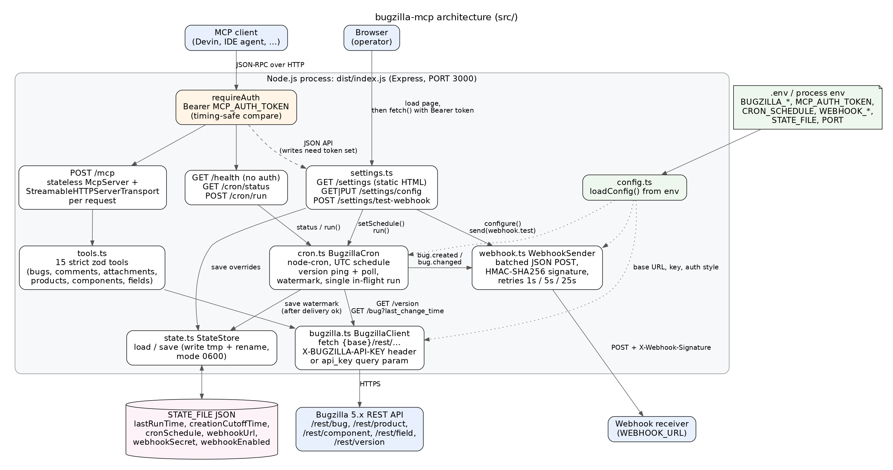

# Architecture

bugzilla-mcp is one Node.js 20 process (`src/index.ts`, built to `dist/index.js`)
that runs an Express server. The server exposes the Bugzilla REST API to MCP
clients as tools, and a scheduled job inside the same process polls Bugzilla
and pushes changes to an outgoing webhook. A static settings page and a small
JSON file hold the runtime configuration for that job.



The diagram source is [`diagrams/architecture.dot`](diagrams/architecture.dot)
(Graphviz). After editing it, run `docs/diagrams/render.sh` to regenerate
[`architecture.png`](diagrams/architecture.png) and
[`architecture.svg`](diagrams/architecture.svg). The script needs `dot`, for
example from `apt-get install graphviz`.

## Modules

| File | Role |
| --- | --- |
| `src/index.ts` | Entry point. Loads config, builds the shared `BugzillaClient`, `StateStore`, `WebhookSender` and `BugzillaCron`, mounts the HTTP routes, starts the cron task, and handles `SIGTERM`/`SIGINT` (stop cron, close the server, force exit after 10 s). |
| `src/config.ts` | `loadConfig()` reads and validates environment variables. `BUGZILLA_BASE_URL` and `BUGZILLA_API_KEY` are required; `BUGZILLA_AUTH_STYLE` must be `header` or `query`; `PORT` must be 1–65535. |
| `src/bugzilla.ts` | `BugzillaClient`: a thin `fetch` wrapper for `{BUGZILLA_BASE_URL}/rest/...` with `get`/`post`/`put`/`version`. It adds the API key (header or query), serializes arrays as repeated query parameters, and raises `BugzillaError` on HTTP errors, non-JSON bodies, or `{"error": true}` responses. |
| `src/tools.ts` | `registerTools()` registers the 15 MCP tools. Each tool's input is a strict zod object, so unknown argument keys are rejected. Custom fields (`cf_*`) are merged in under explicitly typed fields. Results come back as pretty-printed JSON text; errors come back as `isError` results. |
| `src/cron.ts` | `BugzillaCron`: a `node-cron` task on a UTC schedule. Each run pings `GET /rest/version`, polls for changed bugs since the watermark, splits them into created and changed, sends webhooks, and advances the watermark. Concurrent triggers share the single in-flight run. |
| `src/webhook.ts` | `WebhookSender`: POSTs a batched JSON payload (`bug.created`, `bug.changed`, `webhook.test`) with an optional `X-Webhook-Signature: sha256=<HMAC>` header. It retries after 1 s, 5 s and 25 s (four attempts in total) and keeps the last delivery status. |
| `src/settings.ts` | `registerSettingsRoutes()`: the static HTML settings page and its JSON API. It validates and applies schedule and webhook changes live and persists them to the state file. |
| `src/state.ts` | `StateStore`: loads and merges a JSON file at `STATE_FILE`. It writes to `<file>.tmp` with mode `0600`, then renames it over the original. |

## HTTP surface and auth

All routes live on one Express app (`express.json`, 10 MB body limit), and one
error handler returns JSON-RPC-shaped errors (`-32700` for a parse error,
`-32600` for a 4xx, `-32603` for anything else).

| Route | Auth | Handler |
| --- | --- | --- |
| `POST /mcp` | `requireAuth` | Creates a new `McpServer` and a stateless `StreamableHTTPServerTransport` (`sessionIdGenerator: undefined`) for each request; both are closed when the response closes. |
| `GET /mcp` | `requireAuth` | `405`, because only POST is supported. |
| `GET /health` | none | `{"status":"ok"}` |
| `GET /cron/status` | `requireAuth` | `BugzillaCron.status()`: schedule, last run, and webhook state (URL, whether a secret is set, last delivery). |
| `POST /cron/run` | `requireAuth` | Runs the job now; `502` if the run failed. |
| `GET /settings` | none | Static HTML page. |
| `GET /settings/config` | `requireAuth` | Schedule, webhook URL and enabled flag, whether a secret is set, plus the status above. |
| `PUT /settings/config` | token must be configured, then `requireAuth` | Validates and applies `cronSchedule`, `webhookUrl`, `webhookSecret` and `webhookEnabled`. |
| `POST /settings/test-webhook` | token must be configured, then `requireAuth` | Sends a `webhook.test` event with no bugs. |

`requireAuth` compares `Authorization: Bearer <token>` against `MCP_AUTH_TOKEN`
with `timingSafeEqual`. When `MCP_AUTH_TOKEN` is unset, `requireAuth` lets
every request through and the server logs a warning at startup. The two
settings write routes are the exception: they return `403` until a token is
configured.

## MCP request flow

1. A client sends a JSON-RPC message (`initialize`, `tools/list`,
   `tools/call`, ...) to `POST /mcp` with the Bearer token.
2. `index.ts` builds a new `McpServer` with all tools registered, connects a
   stateless transport, and passes the request to it. No MCP session state
   survives between requests.
3. The tool handler validates the arguments with zod and calls
   `BugzillaClient`, which sends the request to Bugzilla with the configured
   API key. Every caller therefore acts as one Bugzilla identity.
4. The Bugzilla JSON (or the error message) is returned as the tool's text
   content. The transport answers with an SSE `message` event, because JSON
   responses are not enabled, so clients must accept both
   `application/json` and `text/event-stream` (otherwise `406`).

Tools and their Bugzilla endpoints are listed in the [README](../README.md#mcp-tools).

## Cron poll and webhook flow

```
tick (node-cron, UTC) or POST /cron/run or the settings page "Run now"
  -> GET /rest/version                       # health check; failure = ok:false
  -> if a watermark exists:
       GET /rest/bug?last_change_time=<watermark>
           &order=changeddate,bug_id&limit=100&offset=...   # at most 1000 bugs
       split: creation_time >= creationCutoff -> bug.created, others -> bug.changed
       if the webhook is enabled: POST bug.created, then bug.changed (one batch each)
  -> if every delivery succeeded (or none was needed): advance the watermark, save it
```

- **First run.** There is no watermark yet, so the first run only pings
  Bugzilla and sets the baseline. Bugs filed before it are never announced.
- **Watermark.** `lastRunTime` advances to the run's start time. When the
  search hit the 1000-bug cap, it advances only to the newest fetched
  `last_change_time`, so the next run picks up the rest. `creationCutoffTime`
  advances only on runs that were not truncated, so a new bug in the
  unfetched tail is still reported as created later.
- **At-least-once delivery.** If any delivery fails after its retries, the
  watermark stays put and the same bugs are sent again on the next run.
  A bug is also sent again (as `bug.changed`) each time its
  `last_change_time` moves, so receivers should dedupe on bug `id` plus
  `last_change_time`, not on `id` alone.
- **Persistence.** The watermark is saved to `STATE_FILE`, so a restart
  resumes from the last successful run. A failed save is logged, but the run
  still counts as successful.

## Settings page

`GET /settings` is one inline HTML page with plain JavaScript; there is no
build step. In the browser, the operator:

1. Enters the `MCP_AUTH_TOKEN` and clicks **Load settings**, which calls
   `GET /settings/config` and fills the form and the status block.
2. Sets **Poll every (minutes)** to a value from 1 to 59. **Save schedule**
   sends `cronSchedule: "*/N * * * *"`, and the cron task is rescheduled
   immediately.
3. Sets the webhook URL, secret, and enabled flag, then clicks **Save
   webhook**. The secret field is write-only: a blank field keeps the current
   secret, and the API only reports `webhookSecretSet`.
4. Uses **Run now** (`POST /cron/run`) and **Send test event**
   (`POST /settings/test-webhook`). The JSON from `/cron/status` appears under
   **Status**.

## Configuration and state precedence

At startup, `index.ts` combines the environment and the state file:

| Setting | Source, highest priority first |
| --- | --- |
| Cron schedule | `STATE_FILE.cronSchedule` → `CRON_SCHEDULE` → `0 9 * * *` |
| Webhook URL | `STATE_FILE.webhookUrl` (an empty string means cleared) → `WEBHOOK_URL` |
| Webhook secret | `STATE_FILE.webhookSecret` (an empty string means cleared) → `WEBHOOK_SECRET` |
| Webhook enabled | `STATE_FILE.webhookEnabled` → true if a URL is set |
| Watermark | `STATE_FILE.lastRunTime` / `creationCutoffTime` |

Settings saved on the settings page override the environment from then on,
including after a restart. To return to environment values, delete the keys
from `STATE_FILE`. The webhook secret is stored in this file in plain text,
which is why the file is written with mode `0600`.

`npm run start:local` and `npm run dev` load `.env` with Node's `--env-file`.
That flag does not override variables already set in the shell, so an
exported `BUGZILLA_API_KEY` wins over the one in `.env`.

## Deployment

The `Dockerfile` is a two-stage `node:20-alpine` build: `npm ci`, then
`tsc`, then `npm prune --omit=dev`. The final image runs `node dist/index.js`
as the `node` user, with `STATE_FILE=/app/data/bugzilla-mcp-state.json`.
`docker-compose.yml` passes the Bugzilla, auth, cron and webhook variables
through, publishes `${PORT:-3000}:3000`, and mounts the named volume
`bugzilla-mcp-state` at `/app/data`, so the watermark and settings survive
container restarts. TLS is not handled by the server; terminate it in a proxy
in front.

## Tests

`npm test` runs `node --test` through `tsx` on `test/*.test.ts`:

- `tools.test.ts` covers strict schemas, custom-field validation and merging,
  and array query serialization in `BugzillaClient` (with a stubbed `fetch`).
- `webhook.test.ts` covers signed delivery, retries and final status, a
  disabled webhook, and `StateStore` merge and persistence.

The tests do not cover the HTTP routes, the cron poll and watermark logic, or
the settings page.
